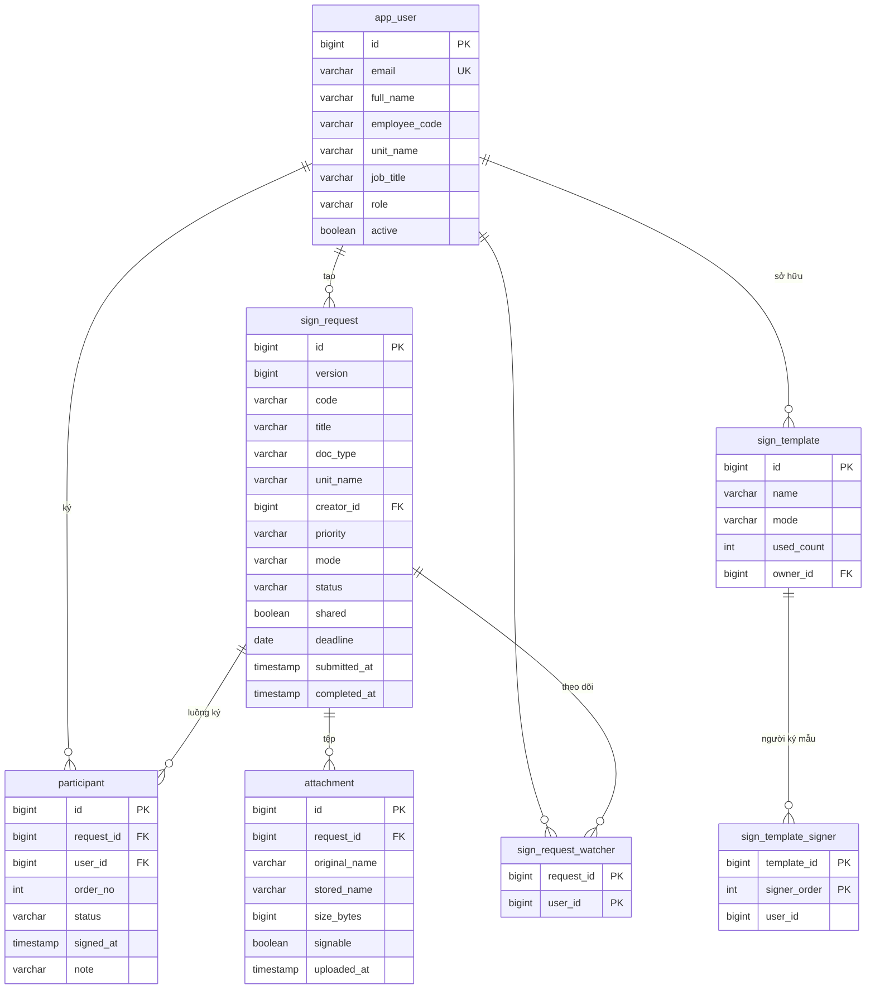

# Cơ sở dữ liệu – KSVB

PostgreSQL, database `ksvb`, schema `ksvb` (đặt bằng `KSVB_DB_SCHEMA`), tài khoản ứng dụng `ksvb_app`.
Profile `h2` và test dùng H2 trong bộ nhớ, schema `public`.

## Flyway
- Migration ở `ksvb-be/src/main/resources/db/migration`. Hiện có `V1__init.sql` (toàn bộ schema ban đầu), `V2__audit_result_outbox.sql` (cột `audit_log.result`, bảng `ksvb_outbox`).
- Backend tự chạy Flyway khi khởi động; JPA ở chế độ `ddl-auto: validate` (lệch entity với bảng thì không khởi động).
- Thay đổi schema = thêm `V2__...sql`, **không sửa** file đã áp dụng.
- Tạo DB lần đầu: `ksvb-be/db/setup-postgres.sql` (role `ksvb_app`, database `ksvb`, schema `ksvb`, `search_path`), chạy bằng tài khoản quản trị Postgres.

## ERD

`doc_counter`, `audit_log` và `ksvb_outbox` đứng riêng (không khoá ngoại).

## Bảng

| Bảng | Nội dung | Ghi chú |
|---|---|---|
| `app_user` | Người dùng KSVB, tạo tự động từ token ở lần đăng nhập đầu | `email` duy nhất; `role` (`USER`/`ADMIN`) chỉ dùng ở chế độ dev; `active=false` thì không chọn vào luồng ký |
| `sign_request` | Văn bản trình ký | `status`: DRAFT/PENDING/COMPLETED/REJECTED/CANCELLED/EXPIRED; `mode`: SEQ/PAR; `priority`: NORMAL/HIGH/URGENT; `code` sinh khi trình ký lần đầu; `version` khoá lạc quan; `message` lời nhắn, `cancellation_reason` lý do huỷ |
| `participant` | Người ký theo thứ tự (`order_no`) | `status`: WAITING/PENDING/SIGNED/REJECTED; `note` ghi chú khi ký hoặc lý do từ chối; xoá theo văn bản (cascade) |
| `sign_request_watcher` | Người theo dõi (chỉ xem) | khoá chính (văn bản, người) |
| `attachment` | Tệp đính kèm | `signable` = tệp cần ký (PDF); `stored_name` UUID trên đĩa (`ksvb.storage.path`) |
| `sign_template`, `sign_template_signer` | Danh sách người nhận mẫu của từng người | `used_count` tăng mỗi lần dùng |
| `doc_counter` | Bộ đếm số hiệu theo `<tiền tố>-<năm>` | khoá ghi (`SELECT … FOR UPDATE`) khi cấp số |
| `audit_log` | Nhật ký thao tác, chỉ thêm | `actor_id` trống = hệ thống (job hết hạn) hoặc không xác định được người; `result` = `OK` / `ERROR` (thao tác ghi bị chặn, action `BLOCKED`, ghi trong transaction riêng) |
| `ksvb_outbox` | Sự kiện chờ đẩy sang hệ thống khác (cùng dạng `hrm_outbox`) | ghi cùng transaction với nghiệp vụ; `status` NEW/SENT/FAILED, `retry_count`, `last_error`; `payload` JSON (id, code, title, docType, status, creatorId, actorId). **Chưa có worker đẩy đi** |

Chỉ mục: `sign_request(status)`, `sign_request(creator_id)`, `participant(request_id)`, `participant(user_id, status)` (cho "chờ tôi duyệt"), `attachment(request_id)`, `audit_log(occurred_at)`, `audit_log(actor_id)`, `ksvb_outbox(status, occurred_at)`.

## Quan hệ với HRM
KSVB **không đọc** `hrm_db`. Tên, đơn vị, chức danh, mã nhân viên lấy từ claim token Keycloak (mapper `employee_code`, `unit_code`, `position_code` do HRM/IAM cấu hình) và lưu bản sao trong `app_user`.
